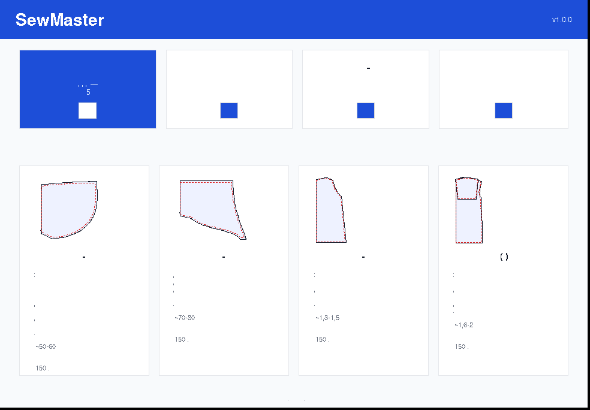
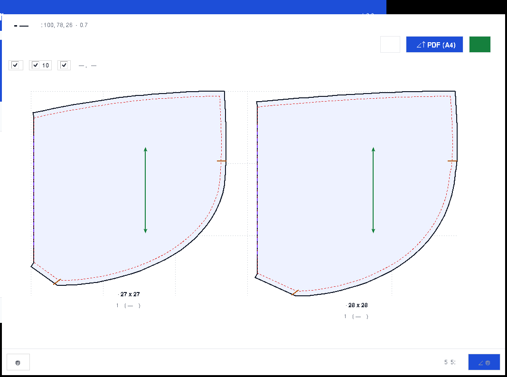
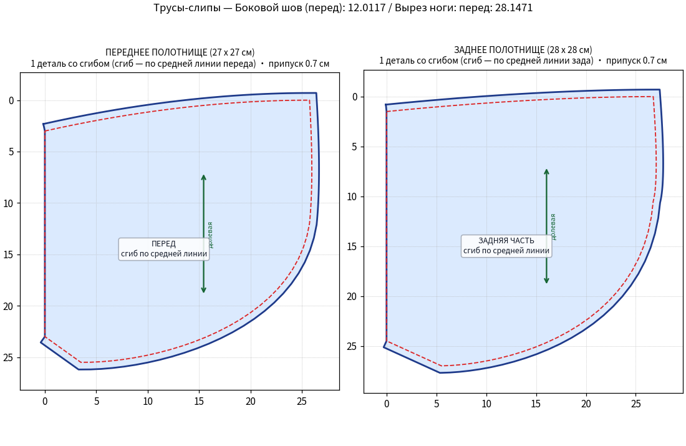
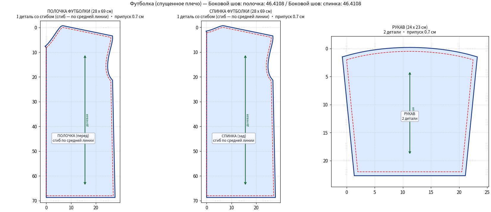

# SewMaster — конструктор выкроек для домашнего пошива

[](https://github.com/alexazver-jpg/SewMaster/actions/workflows/build.yml)
[](LICENSE)
[](https://github.com/alexazver-jpg/SewMaster/releases)

**SewMaster** — программа для Windows, которая строит выкройки белья и лёгкого
верха по вашим меркам, печатает их на обычном принтере (A4, с метками для
склейки листов) и пишет инструкцию по шитью — с учётом того, какая швейная
машина есть у вас дома.

> Программа для людей, которые шьют впервые: каждый шаг объясняется,
> а отсутствие оверлока не проблема — программа предложит альтернативы
> (зигзаг или бельевой шов).

## Возможности

- **4 встроенные модели**: трусы-слипы, трусы-боксёры, майка-безрукавка,
  футболка со спущенным плечом.
- **Мастер из 5 шагов**: модель → мерки (с подсказками, как измерять,
  и заполнением по стандартному размеру) → швейная машина → параметры
  (посадка, резинка, припуски) → предпросмотр.
- **Выкройки строятся по вашим меркам** с припусками на швы, долевой,
  насечками-метками совмещения и линиями сгиба.
- **Печать на A4 в реальном масштабе (1:1)**: контрольный квадрат 10×10 см,
  линии обрезки, круглые метки совмещения листов, нумерация «Лист N из M».
- **Инструкция по шитью для новичка**: пошаговая, со словарём терминов,
  адаптируется под вашу машину (прямострочная / с зигзагом / с оверлоком /
  с распошивалкой) и под ткань.
- **Сохранение проектов** (`.sewproj`) — открыл, поправил мерки, перепечатал.
- **Онлайн-каталог** — дополнительные модели можно скачать из интернета
  без обновления программы.

## Скриншоты

| Главное окно | Предпросмотр выкройки |
|---|---|
|  |  |

| Трусы-слипы (построение) | Футболка со спущенным плечом |
|---|---|
|  |  |

## Скачать и запустить

1. Откройте [страницу Releases](https://github.com/alexazver-jpg/SewMaster/releases).
2. Скачайте **SewMaster.exe** из раздела Assets (установка не требуется).
3. Запустите двойным щелчком.

**Windows 7**: нужен SP1, обновление [KB2533623](https://support.microsoft.com/kb/2533623)
и Visual C++ Redistributable 2015-2019. Если SmartScreen блокирует файл:
«Подробнее» → «Выполнить в любом случае» (файл без цифровой подписи,
исходный код открыт в этом репозитории).

## Как пользоваться

1. **Новая выкройка** → выберите модель.
2. **Мерки**: следуйте подсказкам справа. Не уверены — нажмите
   «Заполнить по размеру» и поправьте пару значений.
3. **Швейная машина**: честно выберите, что у вас есть, — инструкция
   подстроится (для прямострочной машины будут бельевые швы вместо оверлока).
4. **Параметры**: посадка, ширина резинки, припуски. По умолчанию — разумные
   значения.
5. **Результат**: посмотрите выкройку (зум колесом, панорама мышью),
   сохраните проект, экспортируйте PDF и откройте инструкцию.
6. **Печать**: в диалоге печати PDF-просмотрщика выберите масштаб
   **100% / «Реальный размер»**, отключите «подгонку к странице».
   Проверьте квадрат 10×10 см, обрежьте листы по меткам и склейте встык
   по круглым меткам.

## Сборка из исходников

```bash
git clone https://github.com/alexazver-jpg/SewMaster.git
cd SewMaster
pip install -r requirements.txt
python app.py            # запуск из исходников
```

Сборка `.exe` (на машине с Windows или через GitHub Actions):

```bash
pip install -r requirements.txt pyinstaller==5.13.2
pyinstaller --noconfirm --clean --onefile --windowed --name SewMaster ^
  --icon assets/icons/icon.ico --add-data "assets;assets" app.py
```

Или просто запушьте изменения — Actions соберёт exe автоматически
(см. вкладку Actions), готовый файл будет в артефактах сборки.

## Технологии и совместимость

- **Python 3.8.10** — последняя версия Python, официально поддерживающая
  Windows 7. Благодаря этому exe работает на Windows 7 SP1 – Windows 11.
- **tkinter** — встроенный GUI (без тяжёлых зависимостей).
- **ReportLab** — генерация PDF с кириллицей (шрифты DejaVu в комплекте).
- **PyInstaller 5.13.2** (onefile, windowed) — сборка единственного exe.
- Никаких других runtime-зависимостей: онлайн нужен только для каталога.

## Структура проекта

```
app.py                  # точка входа
core/                   # ядро: геометрия, построения, PDF, инструкции
  geom.py               # контуры, кривые Безье, припуски (offset + miter)
  piece.py              # деталь, насечки, долевая, сгибы
  models.py             # реестр моделей, мерки, таблицы размеров
  drafts/               # построения: слипы, боксёры, майка, футболка
  sewing.py             # профили машин и способы швов
  instructions.py       # генератор инструкций для новичка
  pdfout.py             # PDF: титул, разбивка A4, метки, инструкция
  storage.py            # проекты .sewproj и настройки
  catalog.py            # онлайн-каталог моделей
gui/                    # tkinter: главное окно, мастер, предпросмотр
tests/                  # дымовые тесты (python tests/smoke.py)
catalog/index.json      # онлайн-каталог (raw.githubusercontent.com)
AI_CONTEXT.md           # контекст для ИИ-ассистента (дальнейшая разработка)
```

## Разработка с ИИ-ассистентом

В репозитории есть [AI_CONTEXT.md](AI_CONTEXT.md) — файл, по которому
ИИ-ассистент быстро поймёт архитектуру и продолжит разработку после
перезагрузки сессии.

## Лицензия

MIT. Шрифты DejaVu распространяются по своей свободной лицензии
(файл `assets/fonts/LICENSE`).

## Дисклеймер

Методики построения упрощены для домашнего пошива. Перед раскроем дорогой
ткани сделайте пробную модель из старой простыни — это стандартная практика
даже у опытных швей.
